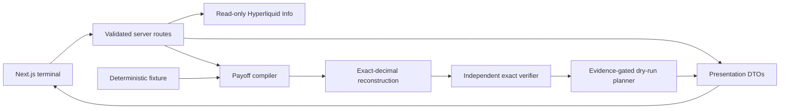

# Contour

> Turn a risk limit into a verified payoff.

Contour is a payoff compiler for Hyperliquid. A trader specifies the position they have and the settlement risk they can tolerate; Contour searches eligible same-underlying, same-settlement HIP-4 liquidity, constructs a low-cost overlay, and independently verifies the resulting payoff.

**Live product:** https://contour-ochre.vercel.app
**Source:** https://github.com/Quenine/contour

## The problem

Trading interfaces are instrument-first. Traders still have to manually translate portfolio-level risk goals into individual contracts, strikes, and sizes. That makes a simple question—“what construction preserves this settlement floor?”—surprisingly difficult to answer with confidence.

## The Contour model

Position → Risk target → Live same-settlement liquidity → Optimization → Exact reconstruction → Independent verification → Evidence-gated dry-run execution planning

Contour starts with a terminal-settlement objective, not a contract recommendation. It:

- reads eligible public outcome-market liquidity for the same underlying and settlement horizon;
- models each observed ask level as separately bounded liquidity;
- optimizes a low-cost buy-only construction;
- reconstructs the proposal with exact decimal values; and
- accepts a result as `FEASIBLE` only when an independent exact verifier passes.

## Why it is different

Contour does not merely:

- browse markets;
- recommend a hedge; or
- display a sampled chart.

The optimizer proposes a candidate. Exact arithmetic reconstructs it. An independent verifier decides whether it is `FEASIBLE`. The chart is explanatory only and never determines pass or fail.

## Liquidity awareness

Each observed ask level becomes a distinct bounded segment. Contour cannot allocate more quantity to a segment than the depth that was actually observed. Live results remain tied to request and market-snapshot identities, so a proof is not presented as belonging to different inputs or a different book.

## Live + deterministic demo

**Verified Fixture Demo** is a deterministic, immediately runnable compiler/verifier path. It uses the same compilation, exact verification, and dry-run planning boundaries without requiring an account, wallet, secret, or live upstream service.

**Live Market** uses public read-only Hyperliquid data. Depending on the current position, requested target, and observed liquidity, a live result may legitimately be `FEASIBLE`, `ALREADY_SATISFIED`, or `INFEASIBLE`. Provider failures and stale data remain explicit; fixture data is never substituted for a live read.

## Execution safety

Payoff feasibility, exact proof, and exchange execution readiness are separate states.

- A construction can be feasible only after exact verification passes.
- The execution planner remains a snapshot-bound dry run.
- Strict live execution is intentionally blocked when authoritative HIP-4 quantity-precision evidence is unavailable.

The public build has no wallet connection, signing, order submission, or broadcast path.

## Architecture



## Correctness boundary

Contour evaluates terminal-settlement payoff over the selected range. It does not provide:

- a liquidation guarantee;
- a fill or execution guarantee;
- a path-dependent or funding guarantee;
- a guarantee of future liquidity, slippage, venue availability, or settlement interpretation; or
- wallet, signing, approval, or order-submission functionality in the current public build.

Fees are excluded where stated. Exact verification applies to the modelled terminal payoff, not to unmodelled venue or account risks.

## Tech stack

- TypeScript and pnpm monorepo
- Next.js App Router and React
- Hyperliquid public read integration
- Exact-decimal domain and payoff layer
- HiGHS WASM optimization
- Vitest and fast-check
- ESLint and TypeScript
- GitHub Actions
- Vercel

## Quick start

Requirements: Node.js 22.13 or newer and pnpm 11.15.1.

```sh
pnpm install --frozen-lockfile
pnpm dev
```

Open `http://localhost:3000`, leave **Verified Fixture Demo** selected, and press **Run verified demo**.

## Quality checks

```sh
pnpm lint
pnpm typecheck
pnpm test
pnpm build
pnpm probe:compiler:fixture
pnpm probe:execution:fixture

# Production smoke, after pnpm start is listening:
pnpm smoke:production -- http://localhost:3000
```

GitHub Actions runs lint, typecheck, unit/property tests, and the production build. Optional live probes are operational observations, not CI dependencies or execution evidence.

## Links

- [Architecture](docs/ARCHITECTURE.md)
- [Payoff model](docs/PAYOFF_MODEL.md)
- [Compiler](docs/COMPILER.md)
- [Execution planner](docs/EXECUTION_PLANNER.md)
- [Protocol execution evidence](docs/PROTOCOL_EXECUTION_EVIDENCE.md)
- [Security](docs/SECURITY.md)
- [Deployment](docs/DEPLOYMENT.md)
- [Hackathon technical brief](docs/HACKATHON_TECHNICAL_BRIEF.md)
