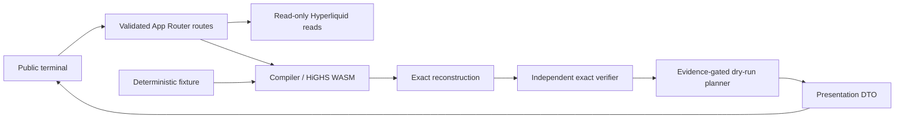

# Contour — Hackathon Technical Brief

**Production:** https://contour-ochre.vercel.app
**Repository:** https://github.com/Quenine/contour

## Product

Contour is a payoff compiler for Hyperliquid outcome markets. It turns a trader’s terminal-settlement risk limit over a selected BTC range into a liquidity-aware, buy-only outcome overlay, then independently verifies the reconstructed payoff with exact decimal arithmetic.

It is an inspection and compilation tool, not an execution product. The public terminal combines a deterministic fixture with a separate read-only live workflow.

## The judge-facing workflow

The terminal makes the causal chain explicit:

**Position → Risk target → Compile → Verify**

For a feasible result, the final presentation shows:

1. **Before** — the existing position’s exact unprotected worst case;
2. **Target** — the requested terminal floor or maximum-loss limit;
3. **Construction** — the selected outcome positions, depth segments, and acquisition premium; and
4. **Verified result** — the exact reconstructed worst case that passed proof.

This BUILD 05 judge-clarity layer is presentation only. It does not move payoff, compiler, verifier, or execution logic into the browser. The sampled chart remains illustrative; exact verification remains authoritative.

## Compiler and verification boundary

Contour models existing perpetual exposure and binary outcome payoff segments over the requested settlement interval. It minimizes acquisition cost subject to:

- the requested terminal PnL floor;
- the acquisition budget; and
- the finite quantity available at every observed ask level.

The numerical solver is a proposal mechanism. Candidate values are reconstructed into exact decimal domain values and passed to an independent interval/boundary verifier. A result is `FEASIBLE` only when that unchanged verifier passes.

### Near-boundary numerical repair

During live testing, a near-boundary solver candidate missed the exact payoff floor by `0.00000000000002`. Contour did not loosen the verifier. Instead, a bounded deterministic exact-decimal repair step may adjust the reconstructed candidate before it is verified again. If exact proof still does not pass, the result is not `FEASIBLE`.

This preserves the intended division of responsibility: the solver searches; exact arithmetic reconstructs; the independent verifier decides.

## Liquidity awareness

Each ask level is represented as a separately bounded construction segment. The compiler cannot consume quantity beyond observed depth, and the UI exposes selected segments beside their available liquidity.

Live compilation is tied to a request identity and an exact book-snapshot identity. Current metadata and books are read without cache substitution; a provider failure remains an explicit unavailable/error state, not a fixture fallback. An `INFEASIBLE` result is a truthful outcome for the eligible snapshot, not a synonym for solver failure.

## Demo and live behavior

The **Verified Fixture Demo** is deterministic and runs the real compiler, exact verifier, and labelled development dry-run planner locally. It requires no account, wallet, secrets, or upstream network.

The **Live Market** path reads public Hyperliquid data and validates it at the server boundary. Depending on the existing position, requested constraint, and eligible same-settlement liquidity, it can return:

- `FEASIBLE`;
- `ALREADY_SATISFIED`; or
- `INFEASIBLE`.

Live provider unavailability, invalid input, verification failure, and solver failure are distinct non-success states. The terminal clears a result whenever compiler-affecting inputs, mode, or market identity change.

## Execution evidence gate

Payoff feasibility does not imply safe exchange execution. The execution planner is a separate, snapshot-bound dry run that:

- normalizes planned quantities, limits, and notionals;
- checks freshness and evidence-backed execution rules; and
- independently verifies the normalized post-plan portfolio.

Strict mainnet execution remains intentionally blocked where authoritative HIP-4 quantity-precision evidence is unresolved. The UI shows the blocker rather than guessing. No wallet, private key, signature, approval, order submission, or broadcast path exists in the public build.

## Architecture

The monorepo separates exact domain values, payoff logic, compiler, Hyperliquid adapter, and execution planner. React receives presentation DTOs only; financial calculations and protocol policy remain server/domain responsibilities.

## Public terminal and deployment

The production terminal is responsive for desktop, tablet, and phone widths. It keeps the workflow, exact result panels, technical tables, and evidence blockers accessible without making chart samples authoritative.

The production deployment is hosted at https://contour-ochre.vercel.app. The application exposes a health endpoint and a system page that remain useful when the upstream provider is degraded. No application secrets are required for the public read-only terminal.

## Quality and operational checks

The repository uses TypeScript, pnpm, Next.js App Router, React, exact decimal models, HiGHS WASM, Vitest, fast-check, ESLint, GitHub Actions, and Vercel.

CI runs lint, typecheck, unit/property tests, and the production build. The production smoke check covers rendered pages, health/build identity, fixture compilation, dry-run preview, headers, and method guards. Deterministic compiler and execution fixture probes are available for local verification; live probes are informational observations only.

## Correctness and risk limits

Contour covers terminal payoff at the specified settlement horizon and price range. It does not guarantee:

- liquidation avoidance;
- future liquidity or fills;
- partial-fill handling beyond the disclosed plan;
- funding, path-dependent risk, fees where excluded, settlement disputes, or venue availability; or
- exchange execution.

Those boundaries are deliberate. Exact proof means the modelled terminal payoff passed independent verification; it does not transform unmodelled market or account risks into guarantees.

## Further reading

- [Architecture](ARCHITECTURE.md)
- [Payoff model](PAYOFF_MODEL.md)
- [Compiler](COMPILER.md)
- [Execution planner](EXECUTION_PLANNER.md)
- [Protocol execution evidence](PROTOCOL_EXECUTION_EVIDENCE.md)
- [Security](SECURITY.md)
- [Deployment](DEPLOYMENT.md)
